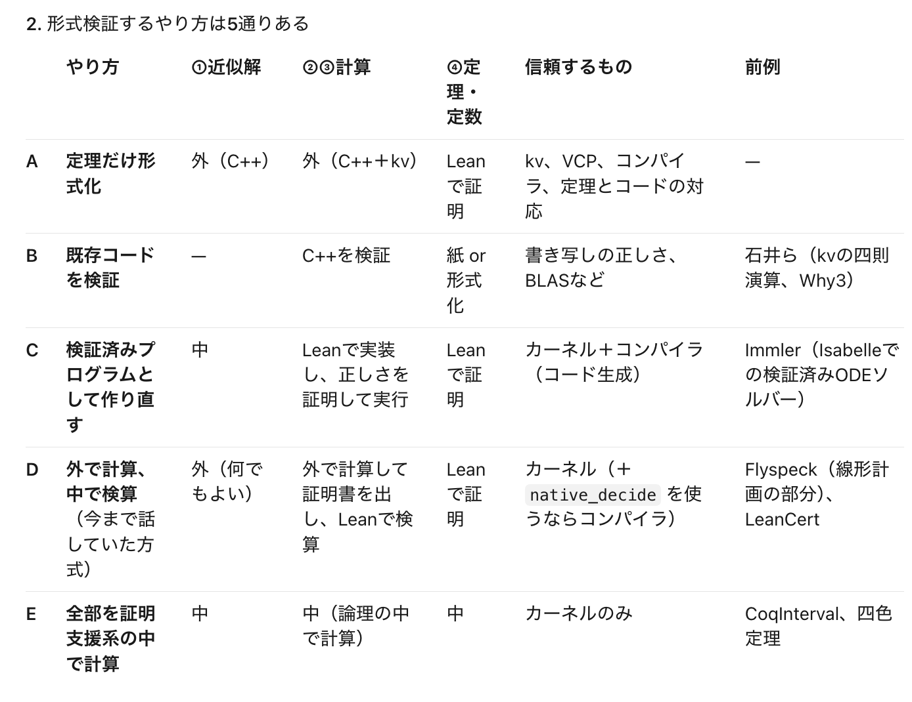

# アイデア

研究テーマ候補

- 『円領域における楕円型偏微分方程式の解の精度保証付き数値法の確立』
- 『半順序付きBanach空間における解の精度保証付き数値法の確立』
- 『精度保証付き数値計算 + 形式証明』

## 構想

まずは，円領域についてやる。次にその精度保証を半順序付きBanach空間上でやれないか試みる。形式証明は空き時間にぽちぽちやる。

## 『精度保証付き数値計算 + 形式証明』

方針1『VCPライブラリの実装の正しさを検証する』

- 石井らの研究の直接の延長
- [https://jssst.or.jp/files/user/taikai/2017/PPL/ppl6-2.pdf]
- Coq, Why3を使う
- タイトルは『Why3を用いたライブラリの検証』

方針2『楕円型方程式の存在証明全体』

- キーワード: certifying algorithm, Lean

現在の研究の基本的な手順
```
① 近似解 û を求める（ガラーキン法 + Newton法）    … 普通の数値計算
② 3つの量を厳密に評価する
     δ：残差 ‖F(û)‖
     K：線形化作用素の逆のノルム ‖F'[û]⁻¹‖
     L：F' のLipschitz定数
③ 条件（例：K²Lδ ≤ 1/2）を確かめる
④ 定理（Newton–Kantorovich型）を適用 → 「û から ρ 以内に解がある」
```



このDができると嬉しい
→C++での実装の正しさを保証できるから
